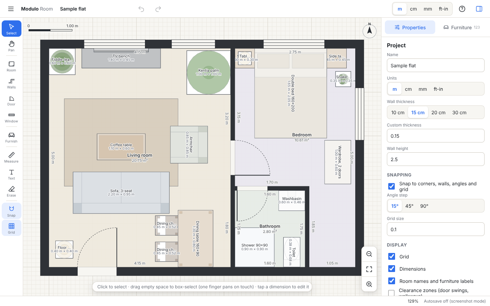
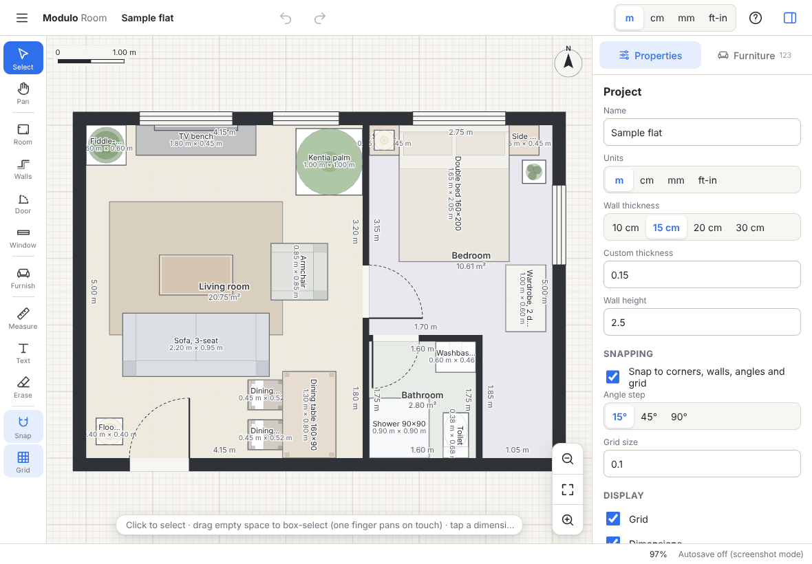
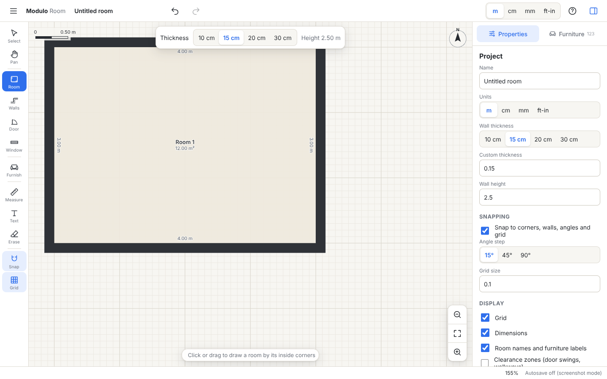
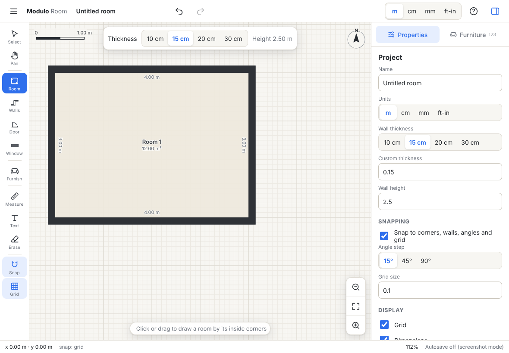
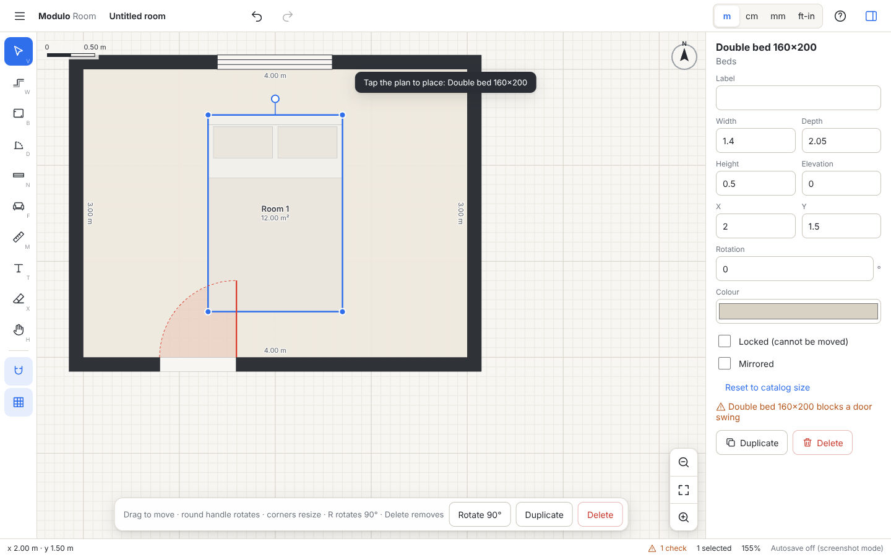
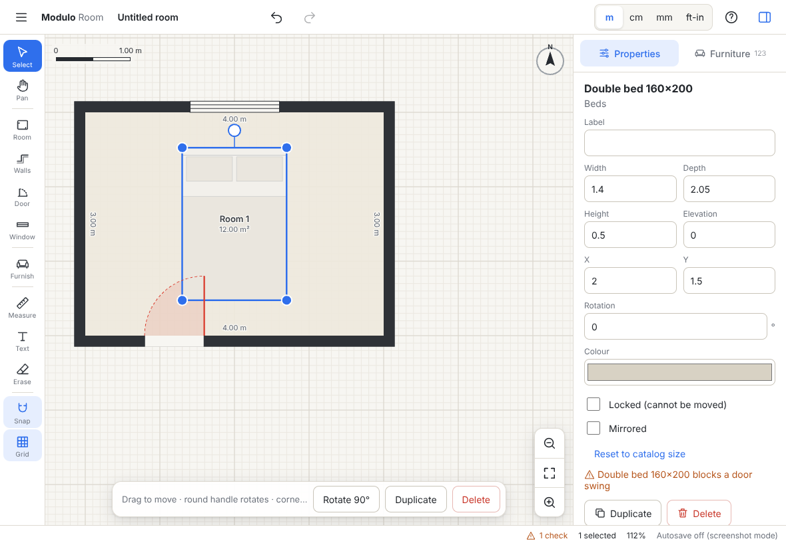
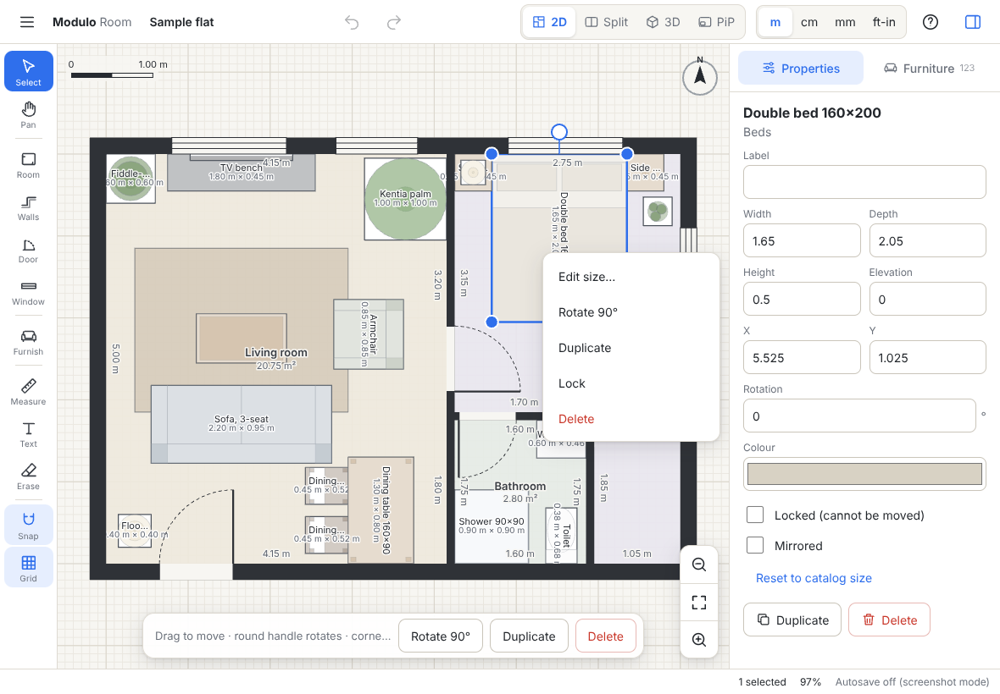
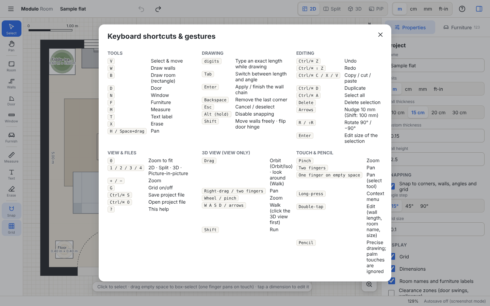
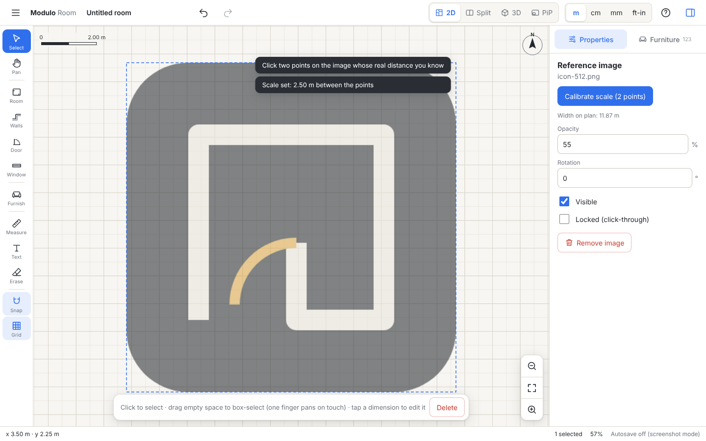

# Phase 1 review — 2D editor (greybox)

## What works

- **Walls**: click-click chains with live length + angle; type a length (and angle) while drawing; closes on the start point; thickness presets 10/15/20/30 cm; sloped walls (start/end height); lock length.
- **Rooms**: detected automatically from the walls (any shape, islands become holes), named, with area; the room tool takes the _inside_ size (`4 × 3 m` = 12.00 m² floor).
- **Exact sizes**: click any inside dimension (or a selected wall's length) to type a value; the wall at the chosen end moves parallel.
- **Doors & windows**: snap onto walls, show distances to the inside corners while placing, door swing arcs; door / double / sliding / plain opening / window; flip hinge and swing side.
- **Furniture**: 44 parametric primitives (beds, sofas, tables, chairs, storage, desk, kitchen, bathroom, plants, lamps, rugs, fixtures, custom box), drawn as top-view symbols; move / rotate (15° snap) / resize by corners or numbers; wall magnet; stacking (lamp on table); lock, mirror, colour.
- **Checks**: furniture overlaps, items cutting into walls, blocked door swings, free space in front of wardrobes, desks, kitchen and bathroom fixtures (clearance zones toggle).
- **Editing**: undo/redo (300 steps), multi-select (shift / marquee), copy / cut / paste / duplicate, nudge, delete, erase tool, measure tool (dimension lines), text labels.
- **Units**: m / cm / mm / ft-in everywhere, input accepts `3.2m`, `320 cm`, `10' 6 1/2"`.
- **Reference image**: import a photo/plan (stays on the device), calibrate with two points + real distance, opacity, rotation, lock.
- **Touch & Pencil**: pinch zoom, two-finger pan, one-finger pan on empty space, long-press context menu, double-tap to edit, large hit targets (44 px), palm rejection while the pencil is in use.
- **Files**: autosave to IndexedDB (asks the browser for persistent storage), save/open `.json` (with embedded images), export SVG and PNG; sample flat; keyboard shortcuts with a `?` overlay.

## Screenshots (Playwright, deterministic screenshot mode)

|                            | Desktop 1440×900                             | iPad 1180×820 (touch)                        |
| -------------------------- | -------------------------------------------- | -------------------------------------------- |
| Sample flat                |     |        |
| Typed 4 × 3 m room         |       |          |
| Furnished + check          |  |     |
| Context menu (long-press)  | —                                            |  |
| Shortcuts overlay          |  | —                                            |
| Reference image calibrated |  | —                                            |

## Numbers

- Unit tests: 55 (units, schema + migration, undo/redo property test, room detection on tricky graphs, mitres, openings, snapping, collisions, catalog validation).
- e2e: 25 Playwright tests (desktop + iPad profiles), fail on any console error.
- 2D performance, 10 rooms + 100 items, headless Chromium on the cloud VM, frames paced by requestAnimationFrame:
  - dragging an item: 9.4 ms avg / 16 ms p95 per frame (incl. full re-normalise, room detection, checks and redraw)
  - dragging a wall corner: 7.9 ms / 9.7 ms
  - panning: 1.6 ms / 2.5 ms
  - not measured on a real iPad yet (please try the deployed build).
- Production bundle: ~180 KB precached (no three.js yet).

## Known gaps / honest limits

- Snapping is relative to world axes; parallel/perpendicular snapping to _non-orthogonal_ walls is not in yet.
- "Lock length" is respected by the length dialog and inspector, but dragging a corner can still change a locked wall.
- Walkway check = clearance zones in front of furniture that needs access (not a full path analysis between rooms).
- Only one level (multi-level is Phase 3); no 3D yet (Phase 2).
- Real Safari not tested here (Chromium with iPad viewport + touch); please check on your iPad.

## Open questions

1. Wall labels: inside dimensions per room + centreline on the selected wall — enough, or do you also want exterior dimension chains around the building?
2. Should doors placed with a mouse keep the tool active (current) and with touch return to Select (current)?
3. Any furniture you miss in the catalog before Phase 2?

## Proposal for Phase 2

3D view synced to the same model: walls with generated openings, floors/ceilings, furniture primitives from the same catalog parts, orbit/top/iso cameras, split view + picture-in-picture, cutaway, first-person walk with collision, select/drag in 3D, render-on-demand, `/bench` route.
