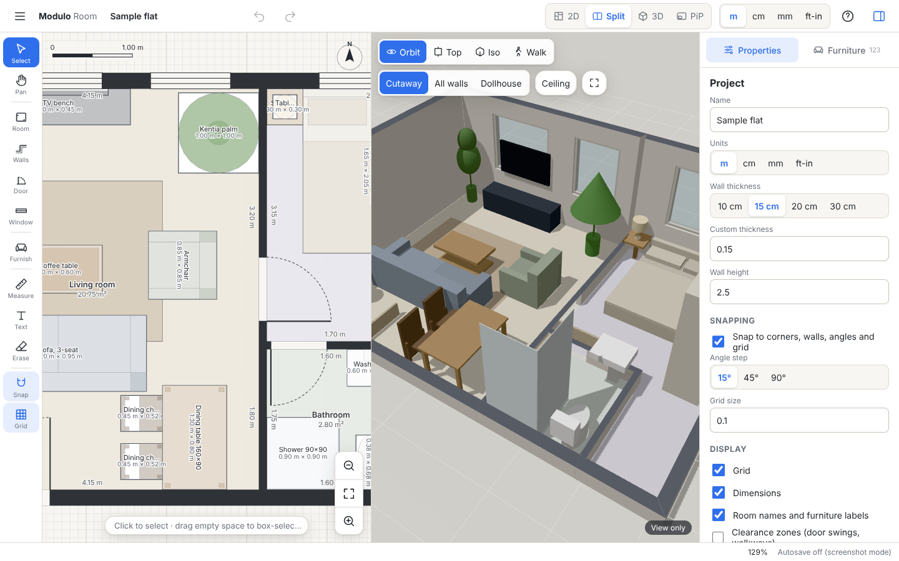
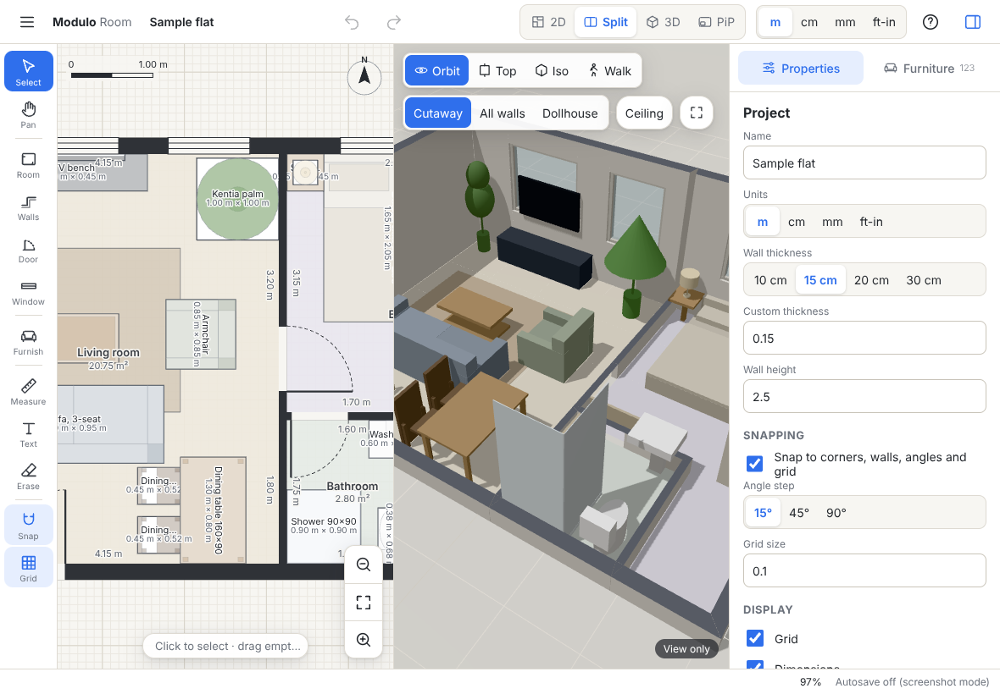
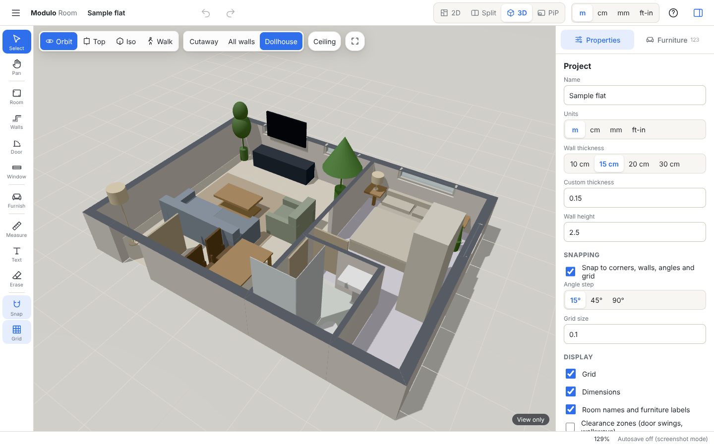
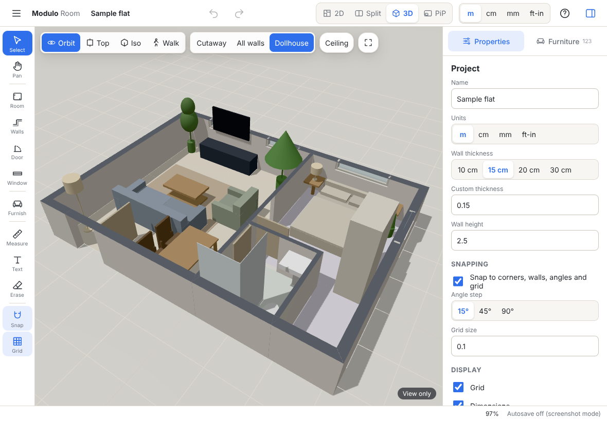
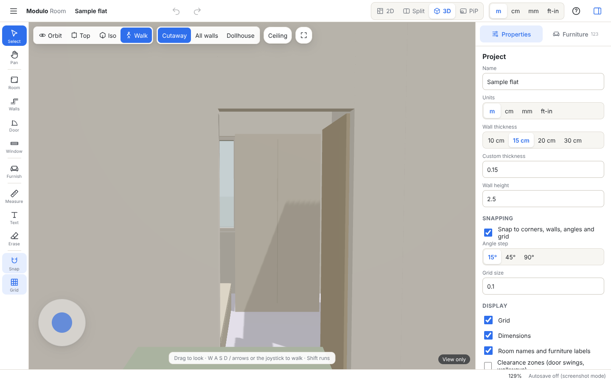
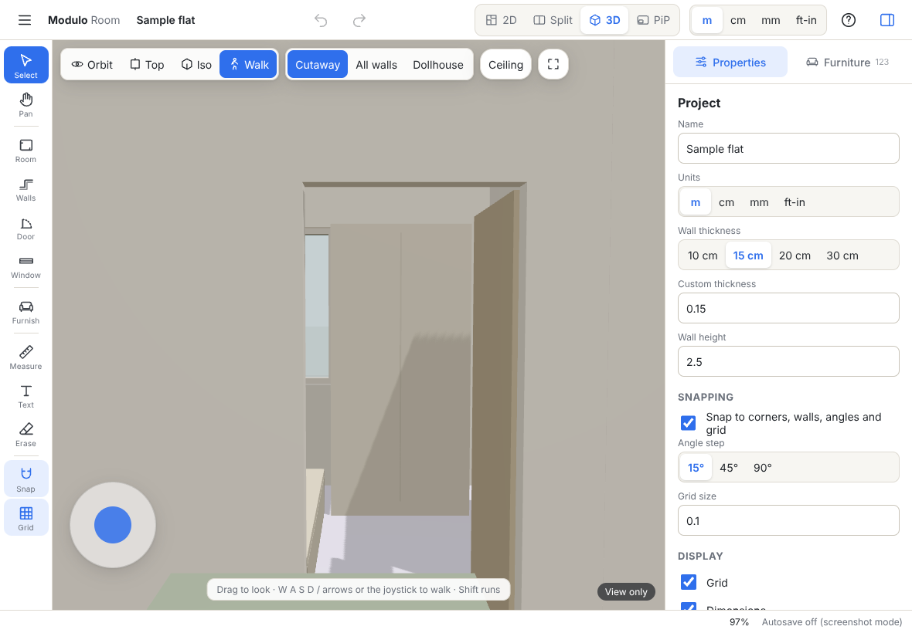
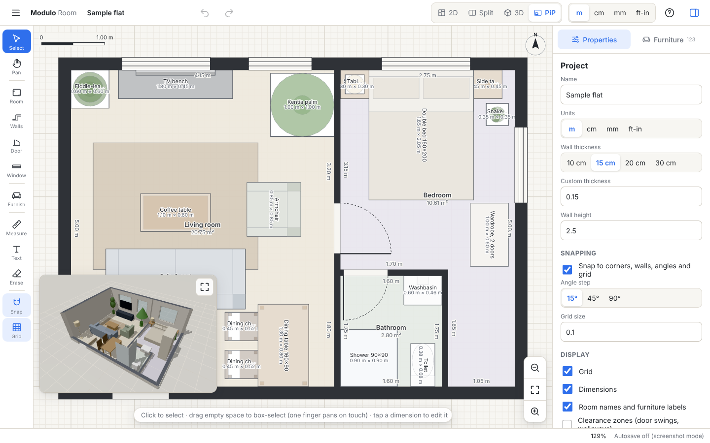
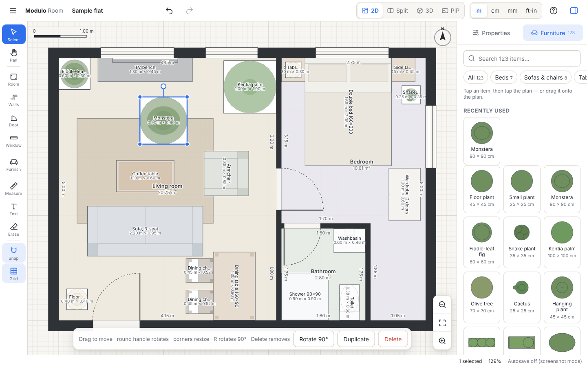

# Review — catalog, UI round and greybox 3D (view-only)

## Catalog & UI

- **123 greybox items** (was 44), all flat-colour primitives at real sizes. New: kids, leisure, more beds/sofas/tables/storage (cube shelves, sliding & corner wardrobes, sideboard), office (corner & standing desk, monitor), kitchen (40/80 units, corner, dishwasher, tall oven, hood, American fridge), bathroom (double basin, bidet, corner bath, walk-in shower, washer-dryer stack, towel radiator, mirror cabinet), lamps (pendant, wall, desk, arc), rugs, structure (straight stairs, columns, fireplace, ceiling fan).
- **13 plants**: floor plant, small plant, monstera, fiddle-leaf fig, snake plant, kentia palm, olive tree, cactus, hanging plant, herb box, plant stand with 3 pots, bonsai, planter box — pots + sphere/cone foliage.
- **Side panel tabs**: Properties | Furniture. Furniture tab: search, category chips with counts, sections, _recently used_, and **drag a card onto the plan** (wall magnet applies) or tap card → tap plan.
- **Toolbar** grouped (navigate · build · furnish · annotate) with text labels.
- **View switch** in the top bar: 2D · Split · 3D · PiP (keys 1–4).

## Greybox 3D (view-only)

- Walls with exact door/window cut-outs and reveals, sloped tops, mitred joints; floors per room (room colour); optional ceilings; door leaves open like the 2D swing; window glass + frames.
- Furniture from the same catalog parts (boxes, cylinders, spheres, cones), merged per shade.
- Cameras: **Orbit**, **Top** (orthographic), **Iso**, **Walk** (drag to look, WASD/arrows or on-screen joystick, collision with walls and furniture, walks through doors).
- Walls: **Cutaway** (walls facing the camera drop low automatically), **All walls**, **Dollhouse**; ceiling toggle.
- Follows every 2D edit live (including drag previews and undo); interacting with 3D never changes the plan.
- Renders only when something changes; three.js loads only when a 3D layout is opened; low-power start after a crash.

## Screenshots

|                       | Desktop                                           | iPad                                      |
| --------------------- | ------------------------------------------------- | ----------------------------------------- |
| Split view            |           |      |
| Dollhouse             |       |  |
| Walk                  |            |       |
| Picture-in-picture    |             | —                                         |
| Plants in the catalog |  | —                                         |

## Numbers

- Tests: 62 unit (incl. exact 3D wall/opening face areas, sloped walls, cutaway clipping), 33 Playwright e2e on desktop + iPad profiles.
- 3D, 10 rooms + 100 items: 340 meshes, 532 draw calls incl. shadow pass; full rebuild 93 ms (once); per-frame CPU 3.4 ms avg / 7.5 ms p95 and live drag update 3.9 / 7.9 ms in headless SwiftShader (software GPU — real GPU frame times need your devices).
- Bundles (gzip): app 58 KB, 3D chunk 152 KB (lazy).

## Not done / next

- No 3D editing (by request). Hover tooltips and "walk to this spot" not yet.
- Real iPad Safari still untested from here.
